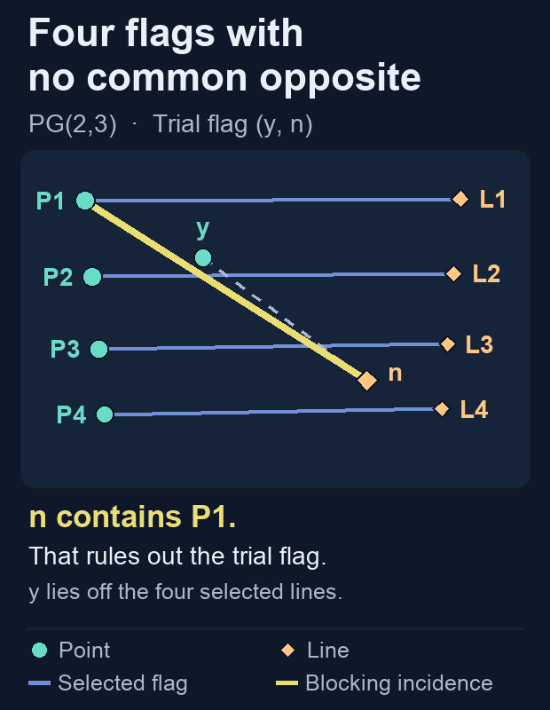

# Sets of flags with no common opposite in finite projective planes

[](https://github.com/DannyExperiments/projective-plane-flags-no-common-opposite/actions/workflows/verify.yml)
[](https://github.com/DannyExperiments/projective-plane-flags-no-common-opposite/actions/workflows/replay.yml)
[](https://github.com/DannyExperiments/projective-plane-flags-no-common-opposite/actions/workflows/pdf.yml)

In every finite projective plane of order s ≥ 3, there are s+1 point–line flags that have no common opposite, with noncollinear point entries and nonconcurrent line entries. In `PG(2,q)` for q ≥ 3, one construction gives all such sets. Their number is q³(q+1)(q²+q+1).

[Read the paper](paper/manuscript.pdf) · [TeX source](paper/manuscript.tex) · [Original conjecture, Remark 5.4 in arXiv v2](https://arxiv.org/html/2602.01110v2#S5.SS1) · [Catalog Q124](https://github.com/10m-u/open-problems-catalog/blob/ca8d4d44ba3db527f19f28928c240168f545ecfe/problems/mathematics/geometry-differential-geometry-part-1.md#q124)

## Explore the proof in 3D



Two flags `(P,L)` and `(y,n)` are opposite exactly when `y` lies off `L` and `n` misses `P`. The four blue edges are the selected flags. The gold edge in the figure shows why one candidate fails. In the explorer you can choose any of the 52 candidates and see its blocking incidences. Circles represent points, diamonds represent lines, and positions are a layout for the incidence diagram.

[Download the offline explorer](visualization/four-flags-explorer.zip) · [HTML source](visualization/index.html) · [GIF rendering source](visualization/render.py)

## Why the construction works

Start with a line `m`, omit one point `R` on it, and choose a point `B` off it. Select `m` and every line through `B` except `BR`. Select `B` and every point of `m` except `R`. Pair one point `A` on `m` with `m`, pair `B` with `BA`, and pair every other selected point `X` on `m` with `BX`.

A candidate point outside all selected lines must lie on the omitted line `BR`. From such a point, the lines to the selected points on `m`, together with `BR` through `B`, are all the lines through it. Every candidate at that point is blocked by one of the selected points on its line.

For the classification in `PG(2,q)`, each uncovered point must be a nucleus of the selected point set. The classical Blokhuis–Wilbrink bound and a line-union bound force equality on both sides. The paper shows how the point and line configurations align and how their incidence pairs are determined once `A` is specified.

## Reproduce the checks

```sh
python3 -I scripts/verify_repository.py
python3 -I verification/src/replay.py
```

The finite replay checks the construction through the stated orders and exhaustively checks the classification in orders 2 and 3. It checks order 4 via a fixed flag and flag transitivity. See [recorded results](verification/results/replay.txt), [reproducibility](REPRODUCIBILITY.md), [scope](CLAIM_SCOPE_AND_LIMITATIONS.md), and [research disclosure](AI_DISCLOSURE.md).
